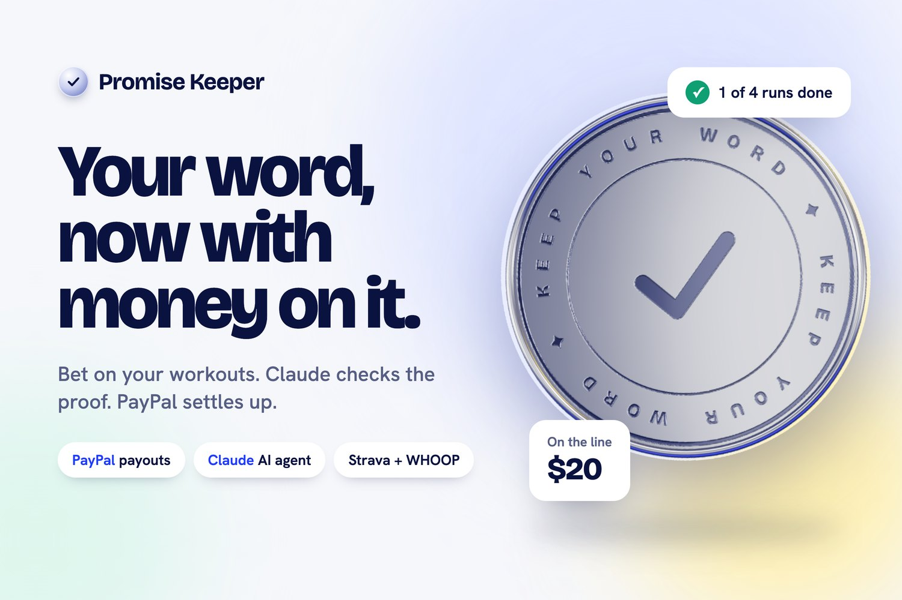
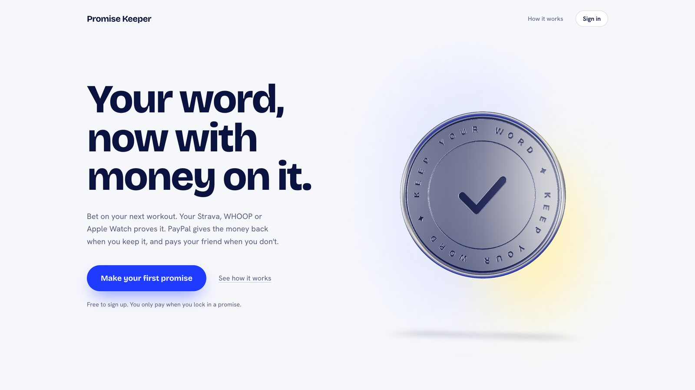
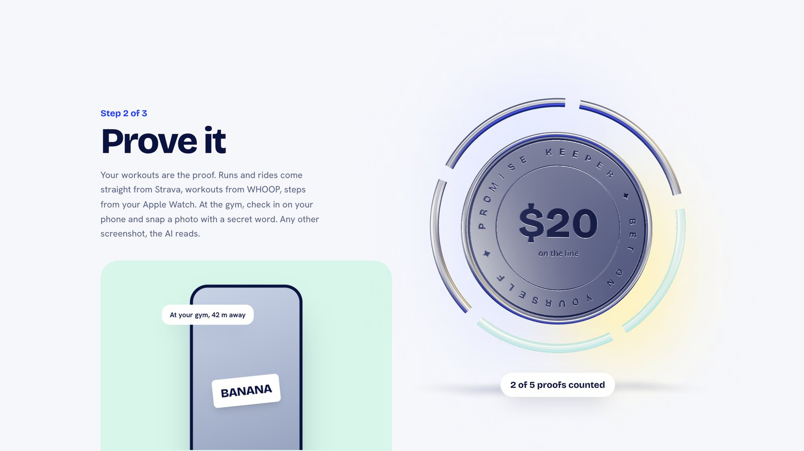
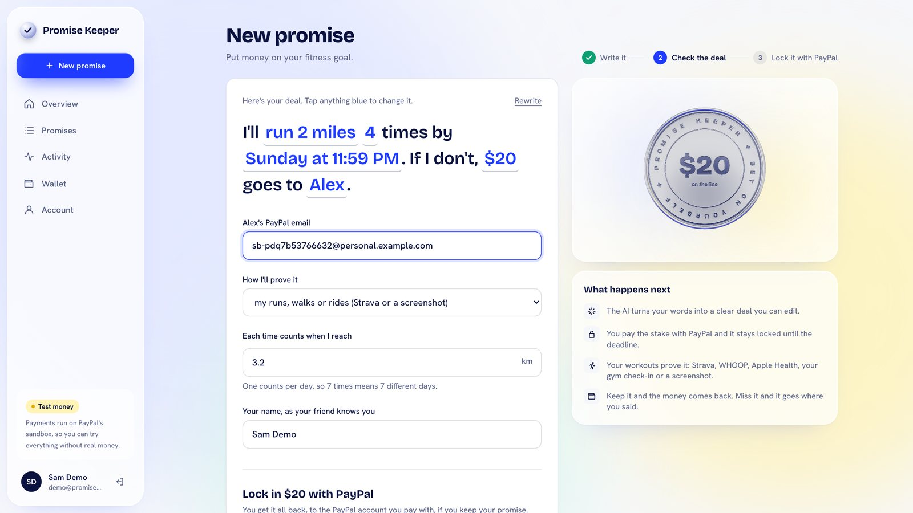
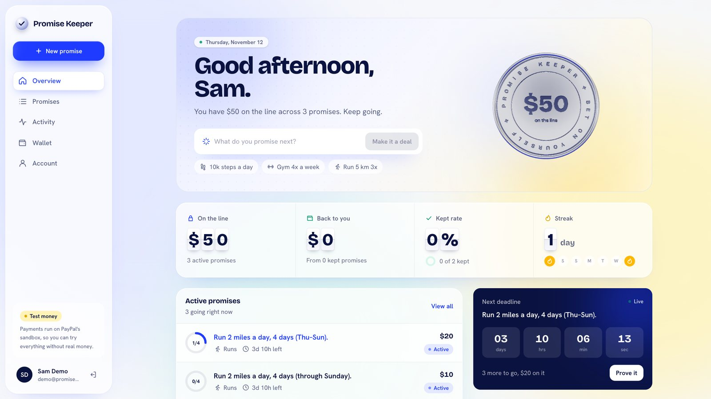
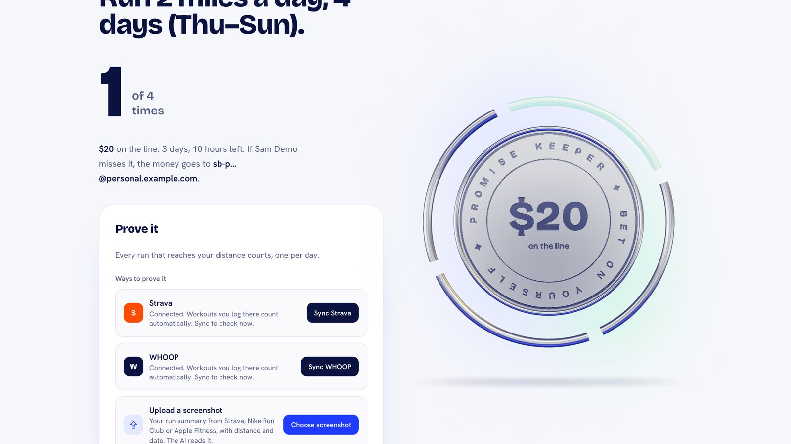
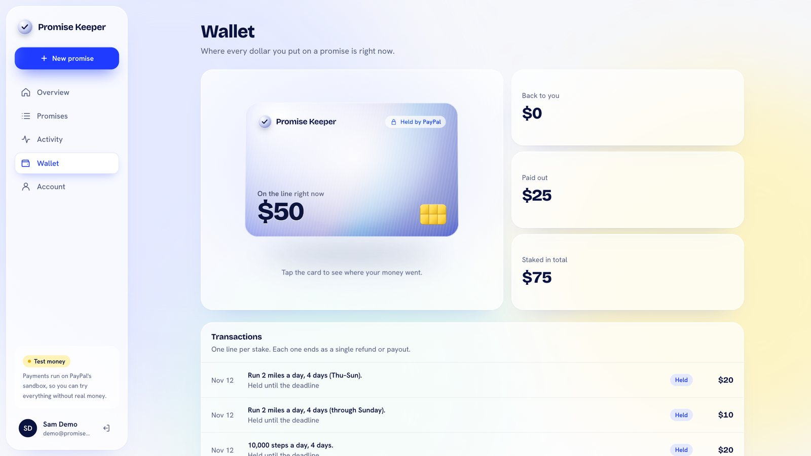
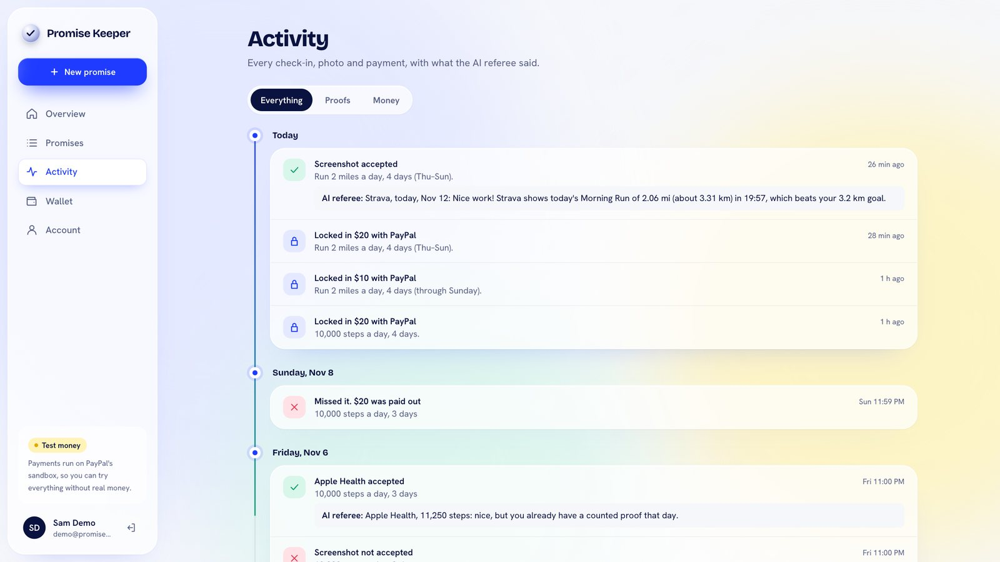
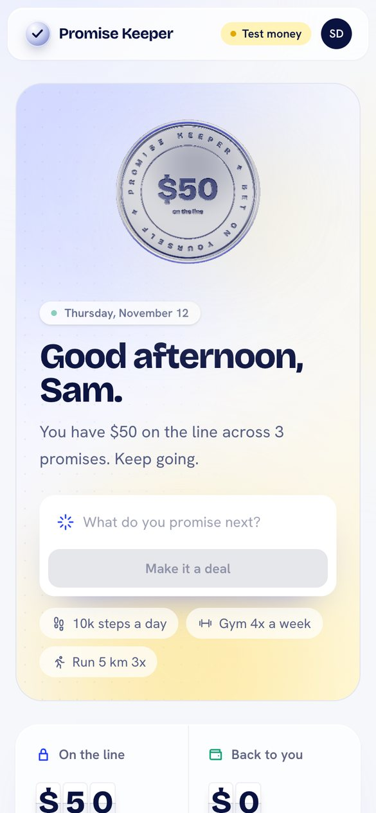

# Promise Keeper



**Your word, now with money on it.**

**Live app:** https://promise-keep.vercel.app (click *Try the demo account* on the sign-in page)

Promise Keeper lets you bet real money on your own fitness goals. Write a promise the way you'd text a friend,
lock in a stake with PayPal, and let your workouts prove it. At the deadline an AI agent settles up on its own:
keep your promise and PayPal refunds every cent; miss it and the money goes to the friend you named.

Built for the **PayPal + AI** hackathon (November 2026). All payments run in the **PayPal sandbox**, so no real
money moves.

---

## How it works

1. **Lock it in.** Type a goal like *"run 2 miles 3 days this week or $10 to Alex"*. Claude turns it into a clear
   deal (run 3.2 km, 3 times, by Sunday 11:59 PM, $10 to Alex) that you can edit word by word. You pay the stake
   with the PayPal button, and the promise only becomes active once PayPal reports the capture as `COMPLETED`.
2. **Prove it.** Your workouts are the proof:
   - **Strava** and **WHOOP**: connect once (OAuth) and recorded runs, walks, rides, hikes and workouts count by
     themselves. Hand-typed (manual) Strava activities are ignored.
   - **Screenshots**: upload a screenshot from Apple Health, the Fitness app (rings), Fitbit, Google Fit, Strava or
     a gym app. Claude reads the number and the date. It must say *Today* or show today's date, and edited,
     reused or old screenshots don't count.
   - **Gym check-in**: your phone confirms you're within 150 m of your gym for 30 minutes, then you take a live
     photo holding a one-time word that Claude checks.
3. **Settle up.** When the deadline passes, the **promise agent** (Claude with tool use) looks at the facts,
   verifies each stake with PayPal, refunds the people who kept their promise, sends the missed stakes to the
   friend through **PayPal Payouts**, and writes each person a short note explaining what happened.

## Screenshots

**Landing page.** The 3D chrome coin acts out each step as you scroll.




**Write a promise in plain words.** Claude turns it into a clear deal you can edit, then you lock in the stake with PayPal.



**Dashboard.** What's on the line, your kept rate and streak, active promises with live countdowns, and the promise agent's log.



**Prove it.** Strava and WHOOP sync on their own, or upload a screenshot that Claude reads and date-checks.



**Wallet and activity.** Every dollar, where it is now, and what the AI referee said about each proof.




**On your phone.**



## Money rules (enforced in code, not by the AI)

- Money is stored as whole cents (integers). `2000` means $20.00.
- Every stake ends as **exactly one refund or one payout**. Nothing is left in limbo.
- Every refund uses a unique `PayPal-Request-Id` and every payout batch a unique `sender_batch_id`, so settling
  is safe to run any number of times.
- Refunds go back to the PayPal account that actually paid (taken from the capture), never a typed email.
- The AI agent chooses the order and the words, but the tools in `backend/settle.py` decide who kept their promise
  and every amount. If the AI is down or stops early, `finish_by_code` completes the same steps.
- Counting rules: inside the promise window, reaches the goal, one counted proof per day, and a source id is
  never counted twice.

## Tech stack

| Part | What |
|---|---|
| Frontend | React 19, Vite, Tailwind CSS 4, Motion, React Three Fiber (the 3D chrome coin), Leaflet (gym map) |
| Backend | Python 3.13, FastAPI |
| AI | **Claude** (`claude-opus-5-5`) via the Anthropic SDK: structured outputs for reading promises, photos and screenshots, and a tool-use loop for the settlement agent. Gemini is an automatic backup. |
| Payments | PayPal REST (Orders, Captures, Refunds, Payouts) and the PayPal Agent Toolkit to verify captures |
| Data and auth | Supabase (Postgres with row-level security, a private storage bucket for proof photos, Auth with email link or Google) |
| Fitness | Strava API and WHOOP API (OAuth) |

```
Browser (React)  ──>  FastAPI backend  ──>  PayPal (orders, refunds, payouts)
   │  PayPal button        │                Claude (deals, photo and screenshot checks, agent)
   │  Supabase sign-in     │                Supabase (Postgres + private photo bucket)
   └───────────────────────┘                Strava / WHOOP (workouts)
```

## How we use PayPal

Everything runs in the **PayPal sandbox** (free developer environment). PayPal holds every stake and moves every dollar.

| PayPal tool | What it does in Promise Keeper |
|---|---|
| **PayPal JavaScript SDK** (PayPal Buttons via `@paypal/react-paypal-js`) | The checkout on the deal screen. The user pays the stake in PayPal's pop-up, with a PayPal login or as a guest with a debit or credit card. |
| **Orders API v2** (`POST /v2/checkout/orders`) | The backend creates an order for the exact stake, so the amount always comes from the server, never the browser. |
| **Orders API v2, Capture** (`POST /v2/checkout/orders/{id}/capture`) | Captures the payment after approval. A promise only becomes active when the capture is `COMPLETED`. The payer's PayPal email is saved from the capture, so refunds go back to the account that paid. |
| **Payments API v2, Refunds** (`POST /v2/payments/captures/{id}/refund`) | Refunds the full stake to people who kept their promise. Each refund sends a unique `PayPal-Request-Id`, so it can never happen twice. |
| **Payouts API** (`POST /v1/payments/payouts`) | Sends a missed stake to the friend in one batch. Each batch has a unique `sender_batch_id`, so PayPal rejects repeats. |
| **PayPal Agent Toolkit** (`paypal-agent-toolkit`, `get_order_details`) | Before the AI agent moves any money, it asks PayPal directly whether the stake was really captured for the right amount. No confirmation, no refund or payout. |
| **OAuth 2.0** (`POST /v1/oauth2/token`) and **sandbox accounts** | Server-to-server authentication with the sandbox app's credentials. Tested with a sandbox business account and personal accounts for a player and a friend. |

Code: [`backend/paypal.py`](backend/paypal.py), [`backend/settle.py`](backend/settle.py), [`frontend/src/components/DealSheet.jsx`](frontend/src/components/DealSheet.jsx).

## How we use AI

**Claude by Anthropic** (model `claude-opus-5-5`, through the Anthropic Python SDK) is the AI in Promise Keeper. Google Gemini is an automatic backup if Claude is unavailable.

| Job | How Claude does it |
|---|---|
| **Promise reader** | Structured outputs turn "run 2 miles every day this week or $20 to Alex" into a deal (run 3.2 km, 4 times, by Sunday 11:59 PM, $20 to Alex). Code then checks every value (stake limits, dates, goal ranges). |
| **Screenshot reader** | Vision plus structured outputs read the distance, steps or minutes and the date from Apple Health, Fitness rings, Strava, Fitbit or gym-app screenshots. Screenshots not from today, edited, or already sent are refused. |
| **Live photo check** | Vision checks that a gym photo shows the one-time secret word and looks like a gym. |
| **Promise agent** | Tool use. At each deadline Claude settles the pot with five guarded tools: get the facts, verify the stake (PayPal Agent Toolkit), refund a winner, send the payouts, and finish with a note for each person. Claude picks the order and writes the notes; the tools decide who kept their promise and every amount, so the AI can never pay the wrong person or pay twice. If the AI is down, the same tools finish in code. |

Code: [`backend/ai.py`](backend/ai.py), [`backend/agent.py`](backend/agent.py), [`backend/settle.py`](backend/settle.py).

## Sponsor tools and other technology

- **Render (sponsor):** hosts the Python/FastAPI backend as a web service deployed from this repo. It is the only part of the app that holds secrets (PayPal, Anthropic, Supabase, Strava and WHOOP keys, all as Render environment variables), and it runs every PayPal call and the Claude promise agent.
- **Vercel:** hosts the React frontend at https://promise-keep.vercel.app.
- **Supabase:** Postgres database with row-level security, sign-in (email link and Google), and a private storage bucket for proof photos.
- **Strava API and WHOOP API:** OAuth connections; recorded runs and workouts count as proof automatically.
- **React Three Fiber / three.js, Motion, Tailwind CSS, Leaflet:** the 3D coin, animations, styling and the gym map.

## Project layout

```
backend/
  main.py            routes: parse, create and capture promises, /me, agent
  fitness_routes.py  Strava / WHOOP connect and sync, screenshot proofs
  proof_routes.py    gym check-in, live word, live photo
  ai.py              Claude calls (Gemini backup), all prompts
  agent.py           the promise agent (Claude tool-use loop)
  settle.py          the guarded money tools the agent calls
  settle_math.py     pure pot-split math
  paypal.py          PayPal REST calls
  fitness.py         counting rules for every proof source
  schema.sql         database schema (plus migrations/)
  tests/             pytest suite with a fake database and fake PayPal
frontend/src/
  pages/             landing, sign-in, public promise page, app screens
  app/               app shell, shared UI, data hooks, idea coins
  components/        deal sheet, prove panel, camera, gym picker
  three/             the 3D coin
  fx/                motion helpers (tilt, count-up, flip-board, magnetic buttons)
```

## Run it locally

You need Python 3.13, Node 20+, a Supabase project, a PayPal developer account with sandbox accounts, and an
Anthropic API key.

**1. Database.** In Supabase, run `backend/schema.sql`, then the files in `backend/migrations/` in order.

**2. Backend** (port 8010)

```bash
cd backend
python3.13 -m venv .venv
.venv/bin/pip install -r requirements.txt
.venv/bin/pip install --no-deps paypal-agent-toolkit==1.11.0
cp .env.example .env        # fill in the keys
.venv/bin/uvicorn main:app --reload --port 8010
```

**3. Frontend** (port 5180)

```bash
cd frontend
npm install
cp .env.example .env.local  # fill in the keys
npm run dev
```

Open http://localhost:5180.

### Environment variables

Backend (`backend/.env`):

| Name | What it is |
|---|---|
| `ANTHROPIC_API_KEY`, `CLAUDE_MODEL` | Claude, the main AI |
| `GEMINI_API_KEY` | Optional backup AI |
| `PAYPAL_CLIENT_ID`, `PAYPAL_SECRET`, `PAYPAL_BASE` | PayPal REST app (sandbox) |
| `SUPABASE_URL`, `SUPABASE_KEY` | Supabase project and its secret key |
| `FRONTEND_ORIGINS`, `APP_URL` | Where the frontend lives (CORS and OAuth return) |
| `STRAVA_CLIENT_ID/SECRET`, `WHOOP_CLIENT_ID/SECRET` | Fitness app OAuth |
| `AGENT_INTERVAL_SECONDS`, `AGENT_KEY` | How often the agent runs; key for `POST /agent/run` |
| `DEMO_MODE`, `DEMO_SAM_EMAIL`, `DEMO_ALEX_EMAIL` | Sandbox demo helpers |

Frontend (`frontend/.env.local`): `VITE_API_URL`, `VITE_PAYPAL_CLIENT_ID`, `VITE_SUPABASE_URL`,
`VITE_SUPABASE_PUBLISHABLE_KEY`, and optionally `VITE_DEMO_EMAIL` / `VITE_DEMO_PASSWORD` for the
"Try the demo account" button.

Secrets live only in the backend `.env`, which is never committed.

## Tests

```bash
cd backend && .venv/bin/pytest
```

The suite uses a fake database and a fake PayPal, and never calls the real Claude API.

## Deploy

- **Backend on Render**: root directory `backend`, build
  `pip install -r requirements.txt && pip install --no-deps paypal-agent-toolkit==1.11.0`, start
  `uvicorn main:app --host 0.0.0.0 --port $PORT`, and the backend environment variables plus
  `PYTHON_VERSION=3.13.0`. A cron job calling `POST /agent/run` (header `X-Agent-Key`) every 10 minutes keeps
  the free server awake so deadlines settle on time.
- **Frontend on Vercel**: root directory `frontend`, with `VITE_API_URL` set to the Render address.
- Then add the Vercel address to `FRONTEND_ORIGINS` / `APP_URL` on Render, to Supabase Auth redirect URLs,
  and to the Strava and WHOOP callback settings.

## Try the demo

1. Open the app and click **Try the demo account** on the sign-in page.
2. Write a promise such as *"run 2 miles 3 days this week or $10 to Alex"* and use a PayPal **sandbox** email for
   the friend.
3. Pay the stake with a PayPal sandbox personal account.
4. Prove it with Strava or a screenshot, or miss it and watch the agent pay your friend at the deadline.

## What it can't stop (yet)

- Fake-GPS apps can fool the gym check-in.
- Sitting in the gym without working out still passes the 30-minute check-in.
- Apple Health has no web login, so Apple data comes from screenshots rather than a direct connection.
  A native iPhone app with HealthKit is the next step.

## License

[MIT](LICENSE)
